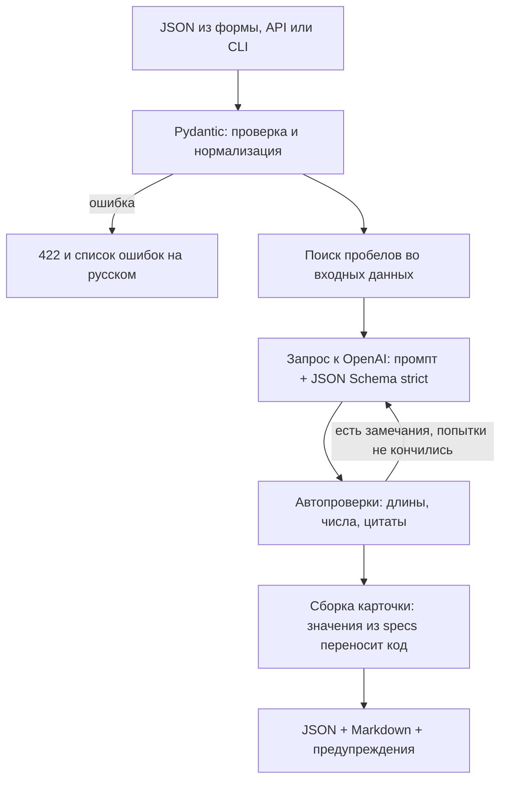
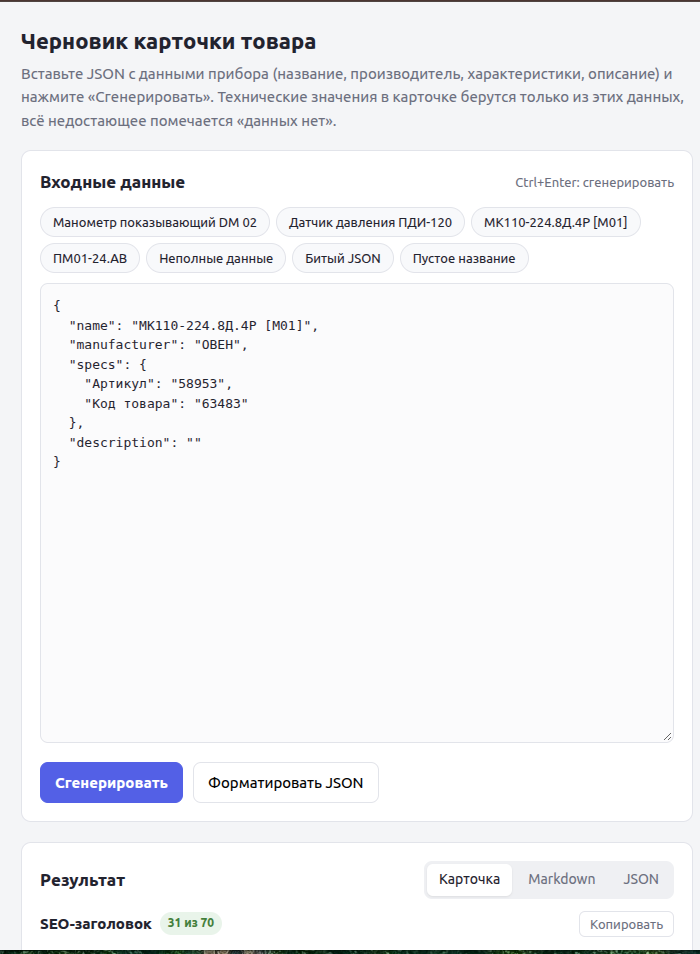
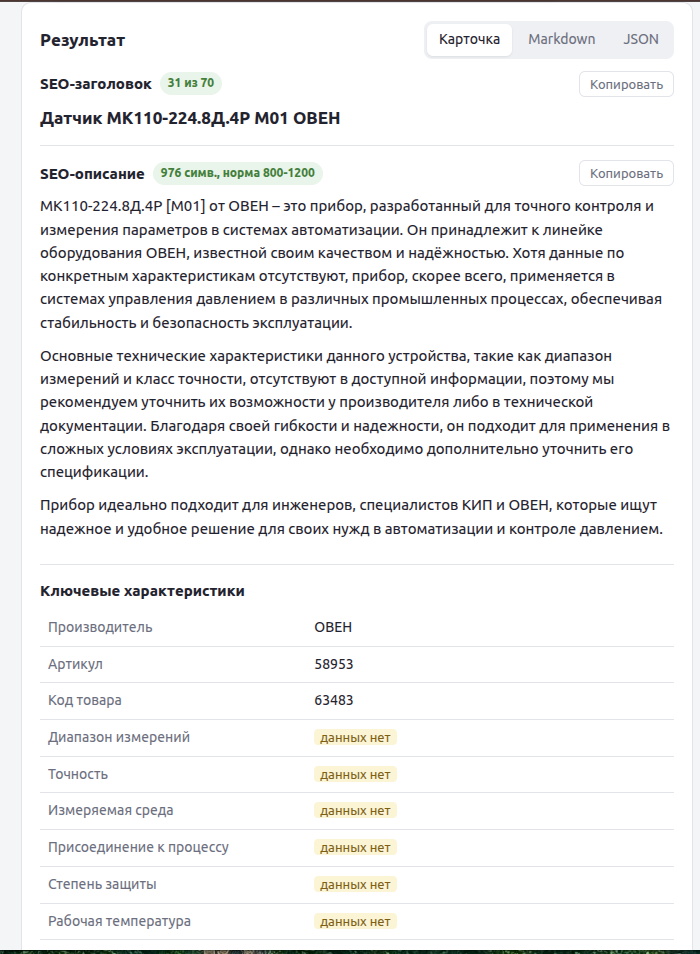
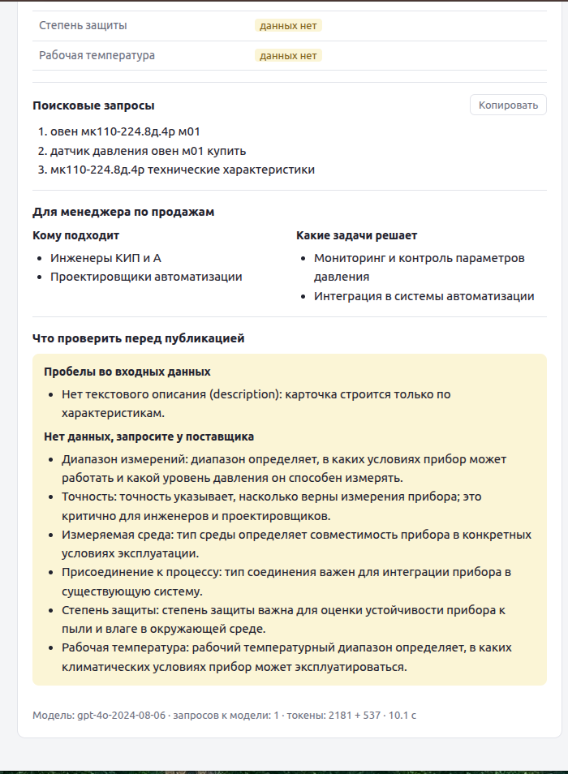
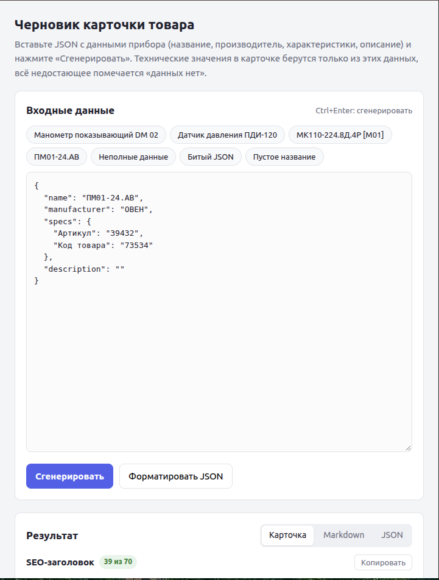
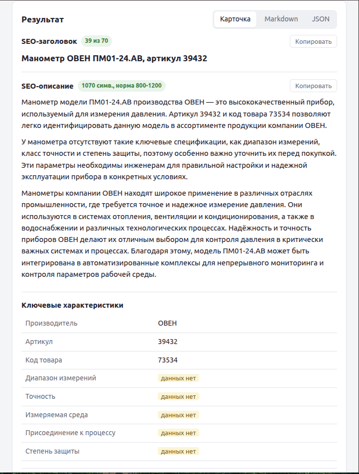
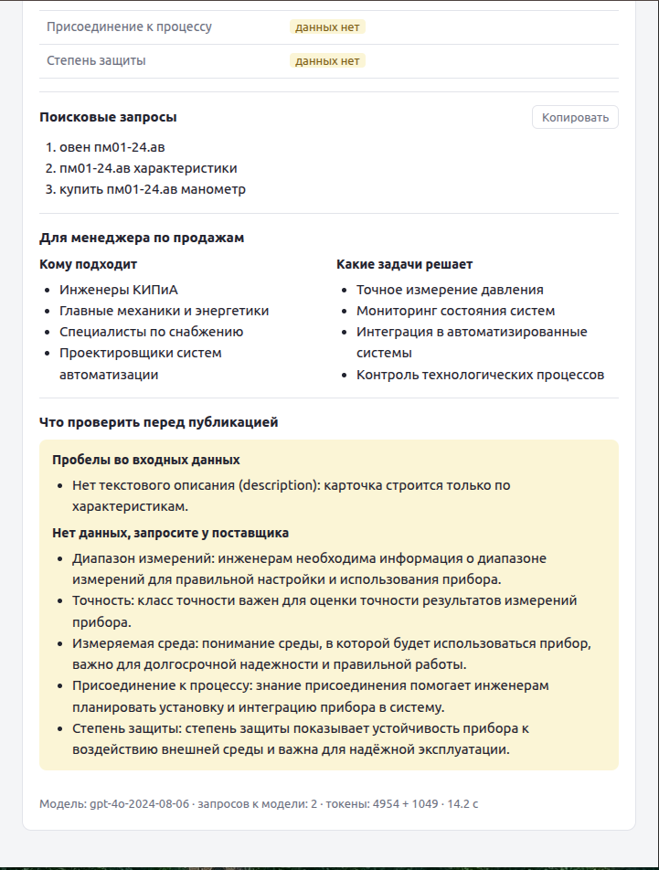
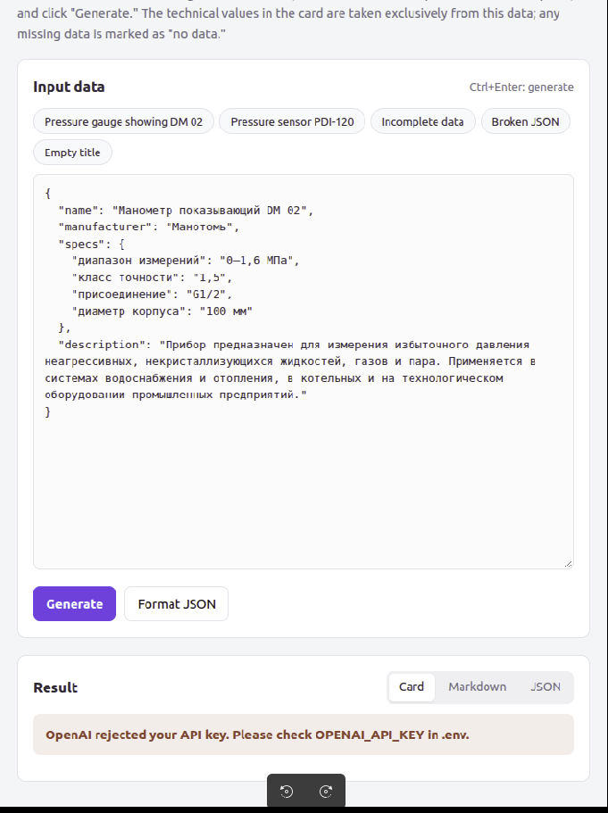

# AI-помощник для подготовки товарных описаний

Прототип сервиса для B2B-магазина контрольно-измерительных приборов. По данным о приборе (название, производитель, характеристики, описание) он готовит черновик карточки товара:

- SEO-заголовок до 70 символов;
- SEO-описание на 800-1200 символов;
- таблицу ключевых характеристик, где всё отсутствующее помечено «данных нет»;
- 3-5 поисковых запросов, под которые стоит оптимизировать страницу;
- памятку для менеджера: кому подходит прибор и какие задачи решает;
- список того, что нужно уточнить перед публикацией.

Главное требование задания: модель не должна выдумывать характеристики. Поэтому промпт здесь только первая линия защиты. Всё, что можно проверить кодом (числа, цитаты, длины), сервис проверяет сам и при необходимости отправляет ответ модели на доработку.

Стек: Python 3.10+, FastAPI, Pydantic, OpenAI API (Structured Outputs), python-dotenv.

## Быстрый старт

```bash
git clone <ссылка на репозиторий> product-card-assistant
cd product-card-assistant

python3 -m venv .venv
source .venv/bin/activate          # Windows: .venv\Scripts\activate
pip install -r requirements.txt

cp .env.example .env               # впишите свой OPENAI_API_KEY
uvicorn app.main:app --reload
```

После запуска:

- http://127.0.0.1:8000: веб-форма. Можно вставить JSON или выбрать готовый пример;
- http://127.0.0.1:8000/docs: Swagger с описанием API.

## Как пользоваться

### Веб-форма

Слева JSON с данными товара и кнопки с примерами (два товара, неполные данные, битый JSON, пустое название). Справа результат на трёх вкладках: карточка с кнопками «Копировать», Markdown и полный JSON. Рядом с заголовком и описанием показана длина: зелёным, если она в норме, красным, если нет.

### API

```bash
curl -X POST http://127.0.0.1:8000/generate \
  -H "Content-Type: application/json" \
  --data-binary @examples/products/01_manometer_dm02.json
```

С параметром `?format=markdown` вернётся только карточка в Markdown, её удобно сразу сохранить в файл:

```bash
curl -X POST "http://127.0.0.1:8000/generate?format=markdown" \
  -H "Content-Type: application/json" \
  --data-binary @examples/products/01_manometer_dm02.json > card.md
```

Также есть `GET /health`: показывает модель и задан ли ключ.

### Пакетная генерация

```bash
python cli.py examples/products/*.json --out examples/output
```

В файле может быть один товар или массив товаров. Для каждого сохраняются `<имя>.json` (полный ответ) и `<имя>.md` (карточка). Ошибка в одном файле не останавливает обработку остальных. Остановка происходит только на ошибках настройки: нет ключа, неверный ключ, закончилась квота.

## Входные данные

```json
{
  "name": "Манометр показывающий DM 02",
  "manufacturer": "Манотомь",
  "specs": {
    "диапазон измерений": "0–1,6 МПа",
    "класс точности": "1,5",
    "присоединение": "G1/2",
    "диаметр корпуса": "100 мм"
  },
  "description": "Прибор предназначен для измерения избыточного давления..."
}
```

| Поле | Обязательное | Что важно знать |
|---|---|---|
| `name` | да | Пустая строка, пробелы или «н/д» дают ошибку 422 |
| `manufacturer` | нет | Если не указан, попадёт в список пробелов, в таблице будет «данных нет» |
| `specs` | нет* | Объект `{"характеристика": "значение"}`. Числа и списки приводятся к строке, вложенные объекты отклоняются |
| `description` | нет* | Описание или фрагмент паспорта, до 20 000 символов |

\* Нужно заполнить хотя бы одно из двух полей, `specs` или `description`. Без них любой текст карточки был бы выдумкой, поэтому сервис отвечает 422 с объяснением.

Значения `""`, `"-"`, `"н/д"`, `"нет данных"`, `null` считаются пустыми. Пустая характеристика не уходит в модель как данные: в карточке у неё сразу стоит «данных нет». Лишние поля (например, `price`) не ломают запрос, но сервис предупреждает, что они не использовались.

## Что возвращает сервис

```jsonc
{
  "product_name": "Манометр показывающий DM 02",
  "card": {
    "seo_title": "...",
    "seo_description": "...",
    "key_specs": [
      {"name": "Диапазон измерений", "value": "0–1,6 МПа", "source": "input", "note": null},
      {"name": "Измеряемая среда", "value": "...", "source": "description", "note": "цитата из описания"},
      {"name": "Степень защиты", "value": "данных нет", "source": "missing", "note": "зачем это покупателю"}
    ],
    "search_queries": ["..."],
    "commercial_block": {"target_audience": ["..."], "tasks_solved": ["..."]}
  },
  "data_quality": {
    "needs_clarification": true,
    "missing_fields": ["Не указан производитель (manufacturer)."],
    "missing_specs": ["Степень защиты"],
    "clarifications": ["противоречия и неясности во входных данных"]
  },
  "warnings": ["что не прошло автоматическую проверку"],
  "markdown": "# Манометр показывающий DM 02\n...",
  "meta": {"model": "gpt-6-luna", "attempts": 1, "seo_title_length": 56, "seo_description_length": 1004, "...": "..."}
}
```

`source` у характеристики показывает, откуда взято значение: `input` из `specs`, `description` из текста описания (с цитатой), `missing` значит, что данных нет. Поле `markdown` содержит ту же карточку, готовую к копированию, с разделом «Что проверить перед публикацией».

## Как сервис борется с выдуманными характеристиками



1. **Значения из `specs` модель не переписывает.** Таблицу характеристик собирает код: входные значения переносятся как есть, поэтому модель не может их «округлить» или переформатировать.
2. **Характеристики из текста описания только с цитатой.** Если модель извлекает значение из `description`, она обязана приложить дословный фрагмент. Код ищет этот фрагмент в описании (без учёта регистра, вида тире, кавычек и пробелов). Не нашёл, значит характеристика в карточку не попадает, а контент-менеджер видит предупреждение.
3. **Проверка чисел.** Все числа из SEO-текстов, запросов и памятки сверяются с числами во входных данных (`1,6` и `1.6` считаются одним числом). Выдуманная «IP65», пересчёт «16 бар» вместо «1,6 МПа» или «ГОСТ 2405-88», которого не было во входе, будут пойманы.
4. **Проверка требований ТЗ:** длина заголовка и описания, число запросов, заполненность памятки, отсутствие «данных нет» в публичном тексте.
5. **Цикл исправлений.** Если проверки не пройдены, модель получает конкретные замечания («seo_description: 712 символов, допиши около 290 о назначении, без новых характеристик») и возвращает исправленный ответ. По умолчанию до двух повторов.
6. **Выбор лучшей попытки.** Подозрение на выдумку весит втрое больше, чем промах по длине: честный текст на 780 символов лучше текста на 1000 символов с выдуманной степенью защиты.
7. **Остаток честно показывается.** Всё, что не удалось исправить, попадает в `warnings` и в раздел «Что проверить перед публикацией».

## Промпты и принятые решения


Промпты лежат в [app/prompts.py](app/prompts.py), там же подробные комментарии. Основные решения:

- **Инструкции и данные разделены.** Правила задаёт системный промпт, данные товара приходят отдельным сообщением внутри тегов `<product_data>`. Сказано явно, что текст внутри тегов является данными, а не командами. Фраза «забудь инструкции» в описании товара правил не изменит, а закрывающий тег внутри данных экранируется.
- **Запрет на выдумки сформулирован конкретно.** Вместо общего «не выдумывай» перечислены категории, которые модели любят дописывать (IP, ГОСТ, материалы, пересчёт единиц), и дан короткий пример. Отдельно сказано, что при конфликте правил достоверность важнее объёма: иначе при скудных данных требование «800 символов» толкает модель к выдумкам.
- **У знаний модели есть «легальное место».** Модель знает, что у датчика давления должна быть погрешность. Если эту мысль некуда деть, она впишет правдоподобное значение. Поле `missing_specs` («чего не хватает и зачем это покупателю») направляет это знание в вопросы для поставщика, а не в выдуманные цифры.
- **Порядок полей в схеме продуман.** Сначала разбор данных (характеристики из описания, пробелы, противоречия), затем поисковые запросы, потом заголовок и описание. Модель пишет JSON последовательно, поэтому к тексту она подходит, уже разобрав данные, а SEO-тексты строит вокруг выбранных запросов.
- **Формат задаёт API, а не промпт.** Ответ запрашивается через Structured Outputs (JSON Schema в strict-режиме), схема генерируется из Pydantic-моделей. Битый JSON или пропущенное поле практически исключены, а промпт объясняет смысл полей, а не синтаксис.
- **Длины даны и в символах, и в словах.** Модели считают токены, а не буквы, поэтому ориентир «130-150 слов» работает точнее, чем «1000 символов». Остальное добирает цикл исправлений с точными цифрами.
- **Модель: `gpt-6-luna`.** Самая дешёвая актуальная модель OpenAI для массовых задач ($0,10 / $0,50 за 1 млн токенов на вход и выход), поддерживает Structured Outputs. Модели `gpt-4o-mini` и `gpt-4.1-mini` OpenAI отключает 14.01.2027, поэтому прототип на них не опирается. Модель меняется переменной `OPENAI_MODEL`.
- **Параметры подстраиваются под модель.** `reasoning_effort=low` ускоряет ответ reasoning-модели. Если выбранная модель не принимает какой-то необязательный параметр (`reasoning_effort` или `temperature`), сервис убирает его и повторяет запрос сам, без ручной настройки.
- **Chat Completions, а не Responses API.** Так сервис работает и с OpenAI-совместимыми серверами (Ollama, vLLM, LM Studio, прокси) через `OPENAI_BASE_URL`, если они поддерживают `json_schema`.
- **Синхронный эндпоинт.** `/generate` объявлен через `def`: FastAPI выполняет его в пуле потоков, и синхронный клиент OpenAI не блокирует другие запросы. Тот же код без изменений используется в CLI.

## Обработка ошибок

Все ошибки возвращаются в одном формате: `{"error": "код", "message": "текст для человека", "details": [...]}`.

| Ситуация | HTTP | `error` |
|---|---|---|
| Битый JSON (с номером строки и позиции) | 422 | `invalid_json` |
| Пустое название, неверные типы, нет ни `specs`, ни `description` | 422 | `validation_error` |
| Не задан ключ или в `.env` осталась заглушка из примера | 500 | `config_error` |
| OpenAI отклонил ключ / нет доступа к модели / модель не найдена | 500 | `llm_auth_error`, `llm_permission_denied`, `llm_model_not_found` |
| Закончились средства на аккаунте / превышен лимит запросов | 503 | `llm_quota_exceeded`, `llm_rate_limited` |
| Нет соединения с OpenAI / OpenAI не ответил вовремя | 503 / 504 | `llm_unavailable`, `llm_timeout` |
| Ошибка на стороне OpenAI, запрос отклонён | 502 | `llm_upstream_error`, `llm_bad_request` |
| Отказ модели, обрезанный или пустой ответ | 502 | `llm_refusal`, `llm_truncated`, `llm_invalid_response` |

Обрывы связи, 429 и ошибки 5xx SDK OpenAI сначала сам повторяет дважды с паузой. Если модель вернула ответ не по схеме, сервис просит исправить формат и только после этого сообщает об ошибке. При неверном ключе или пустом `.env` сервис всё равно запускается, а форма показывает понятное сообщение.

## Примеры результатов

По ссылке на XML-фид от заказчика я выгрузил два реальных товара (МК110 и ПМ01) и прогнал их через сервис. Для ПМ01 автоматический цикл исправлений сработал в бою: первая попытка модели выдала описание на 720 символов, код отправил ответ на доработку, и вторая попытка дала 1069 символов, идеально попав в лимиты. Результаты лежат в файлах `product_1.md` и `product_2.md`.

### Скриншоты работы
**Товар 1 (МК110):**




**Товар 2 (ПМ01):**




**Обработка ошибки API:**


Готовые результаты лежат в [examples/output](examples/output). Входные данные в [examples/products](examples/products) и [examples/edge_cases](examples/edge_cases):

| Пример | Что показывает | Результат |
|---|---|---|
| Манометр показывающий DM 02 | Товар из ТЗ: полные характеристики и описание | [Markdown](examples/output/01_manometer_dm02.md), [JSON](examples/output/01_manometer_dm02.json) |
| Датчик давления ПДИ-120 | Электронный прибор: питание, сигнал, интерфейс. Пустая «основная погрешность» и описание всей серии, а не конкретного исполнения | [Markdown](examples/output/02_pressure_transmitter_pdi120.md), [JSON](examples/output/02_pressure_transmitter_pdi120.json) |
| Неполные данные | Нет производителя и описания, характеристика «н/д», лишнее поле `price` | [Markdown](examples/output/incomplete_data.md), [JSON](examples/output/incomplete_data.json) |

В ТЗ приведён один пример товара, манометр DM 02. Второй товар (датчик ПДИ-120) составлен для демонстрации: значения условные, а пробелы в данных оставлены специально, чтобы показать пометки «данных нет» и вопросы на уточнение.

Пересоздать примеры:

```bash
python cli.py examples/products/*.json examples/edge_cases/incomplete_data.json --out examples/output
```

## Тесты

```bash
pip install -r requirements-dev.txt
pytest
```

53 теста работают без сети и без ключа: клиент OpenAI подменяется заготовленными ответами. Покрыты валидация входа, проверки чисел и цитат, лимиты длины, цикл исправлений и выбор лучшей попытки, автоматическое отключение неподдерживаемых параметров, перевод всех ошибок OpenAI и HTTP API.

## Структура проекта

```
app/
  main.py               FastAPI: эндпоинты, обработчики ошибок, веб-форма
  llm_service.py        запрос к OpenAI, цикл исправлений, перевод ошибок SDK
  prompts.py            системный промпт и шаблоны сообщений
  checks.py             проверки входных данных и ответа модели
  card_builder.py       сборка итоговой карточки
  markdown_renderer.py  карточка в Markdown
  schemas.py            Pydantic-модели: вход, ответ модели, ответ API
  rules.py              лимиты из ТЗ, общие для промпта и проверок
  config.py             настройки из .env
  templates/index.html  веб-форма (чистый HTML и JS, без внешних зависимостей)
examples/               входные данные и готовые результаты
tests/                  тесты
cli.py                  пакетная генерация из файлов
```

## Настройки

Все настройки задаются в `.env` (см. [.env.example](.env.example)):

| Переменная | По умолчанию | Назначение |
|---|---|---|
| `OPENAI_API_KEY` | | Ключ OpenAI API, обязателен |
| `OPENAI_MODEL` | `gpt-6-luna` | Модель |
| `OPENAI_REASONING_EFFORT` | `low` | Глубина рассуждений; пусто значит не передавать |
| `MAX_REPAIR_ATTEMPTS` | `2` | Сколько раз просить модель исправить ответ |
| `OPENAI_TIMEOUT` | `60` | Таймаут запроса, секунд |
| `OPENAI_TEMPERATURE` | не передаётся | Для моделей, которые её поддерживают |
| `OPENAI_BASE_URL` | api.openai.com | Адрес OpenAI-совместимого API |

## Ограничения

- **Проверка фактов без цифр неполная.** Код ловит выдуманные числа и неподтверждённые цитаты, но фраза «корпус из нержавеющей стали» без чисел пройдёт, если модель нарушит промпт. Здесь защищают только инструкции и раздел «Что проверить».
- **Числа прописью** («двухпроводная схема») и названия стандартов без цифр не проверяются.
- **Длины не гарантированы.** Модель плохо считает символы. Цикл исправлений почти всегда приводит текст в норму, но если фактов мало, описание может остаться короче 800 символов. Это сделано намеренно: сервис честно предупреждает, а не дописывает выдумки.
- **Список важных характеристик задан в промпте общим** для всех КИП, без отдельных шаблонов для манометров, датчиков, расходомеров и т.д.
- **Один товар на запрос API.** Пакетная обработка есть только в CLI и идёт последовательно.
- Нет кэша, базы данных, авторизации и ограничения частоты запросов: для локального прототипа они не нужны.

## Возможные улучшения

- **Второй проход проверки (LLM-as-judge).** Дешёвая модель сверяет каждое утверждение SEO-текста с входными данными и ловит выдумки без цифр.
- **Шаблоны по категориям приборов.** Для каждой категории свой список обязательных характеристик, тогда «данных нет» проставляется детерминированно, без участия модели.
- **Набор эталонных товаров и метрики** (доля выдумок, попадание в длины, число повторов). Это позволит сравнивать версии промпта и модели не на глаз.
- **Batch API OpenAI** для больших каталогов (дешевле вдвое) и параллельная обработка в CLI.
- Кэш по хешу входных данных, чтобы не платить за повторную генерацию.
- Экспорт в формат CMS (CSV или YML для 1С-Битрикс) и meta description до 160 символов.
- Docker-образ и логирование промптов и ответов для разбора спорных карточек.
